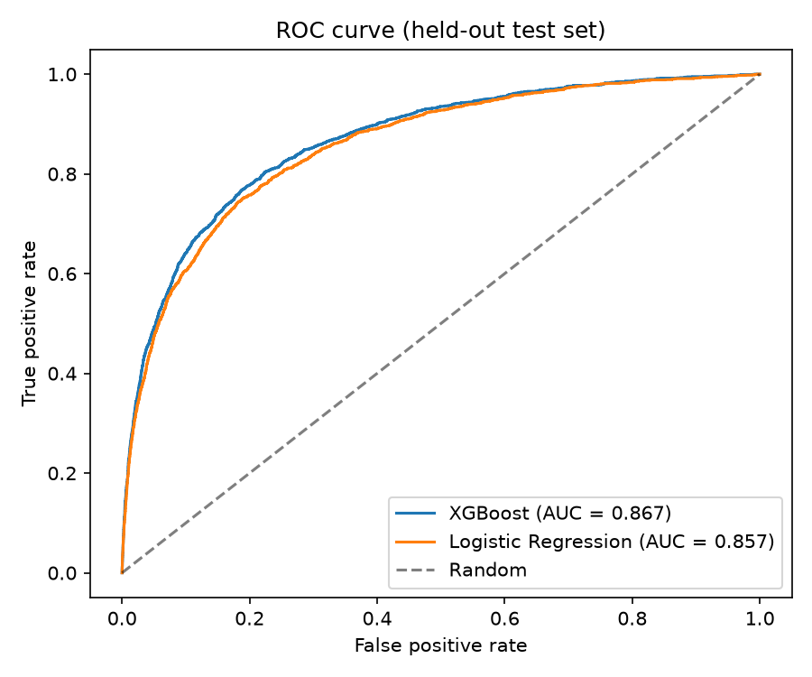
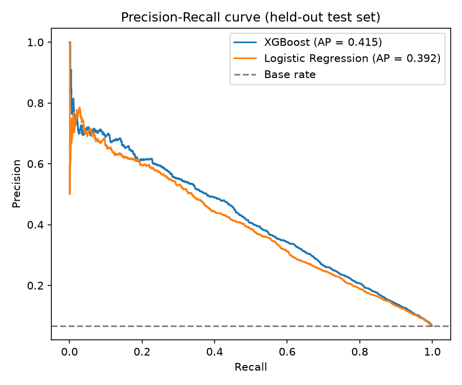
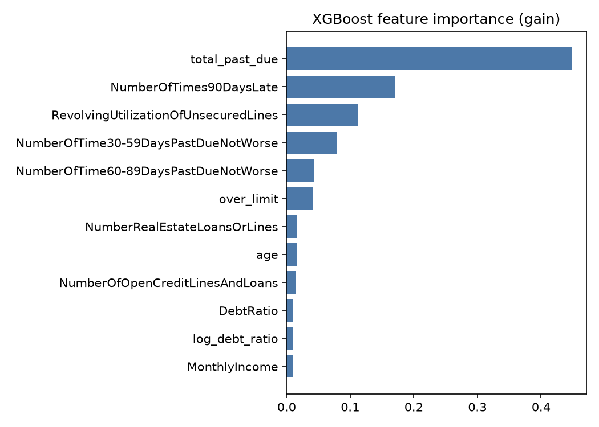
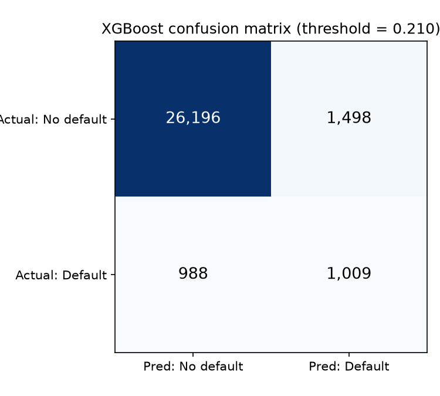
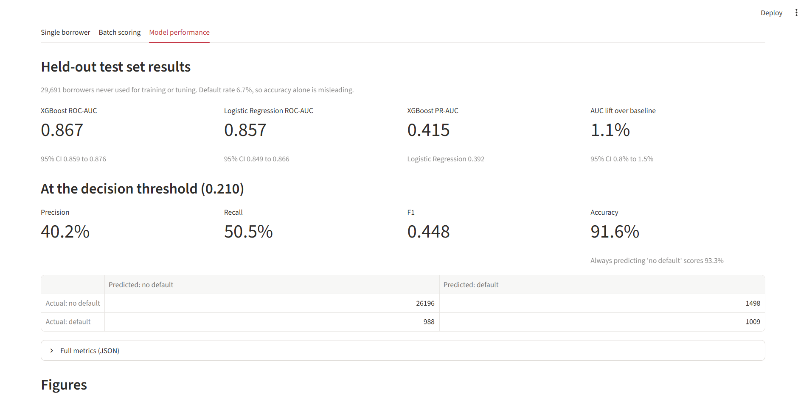
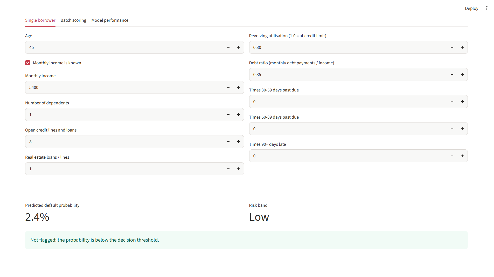

# Credit Risk Predictor

Predicts whether a borrower will become seriously delinquent (90+ days past due) within two years, using the Kaggle **Give Me Some Credit** dataset (150,000 borrowers).

## Problem and objective

Lenders need to rank borrowers by default risk. Only 6.7% of borrowers in this dataset default, so the target is imbalanced and accuracy alone is misleading. The objective is to build a leakage-safe pipeline that ranks borrowers well (ROC-AUC and PR-AUC), compare a tuned XGBoost model with a tuned Logistic Regression baseline, and expose the result through SQL analysis, a Power BI dashboard and a Streamlit app.

## Approach

1. **Cleaning:** remove invalid ages (outside 18-100) and 609 duplicate rows, treat the 96/98 placeholder codes in the past-due columns as missing (keeping a flag), cap extreme outliers. 150,000 rows become 148,452.
2. **Features:** the 10 raw features plus 7 engineered ones (placeholder-code flag, missing-income flag, total past-due count, log income, log debt ratio, income per dependent, over-limit flag), 17 in total.
3. **Split:** stratified 80/20 train/test split (118,761 / 29,691 rows); the test set is used once at the end.
4. **Models:** class-weighted Logistic Regression (C tuned by grid search) as a fair baseline, and XGBoost tuned with randomised search (25 iterations) and 5-fold stratified cross-validation on ROC-AUC.
5. **Threshold:** the F1-optimal threshold (0.210) is chosen on out-of-fold training predictions, never on the test set.
6. **Evaluation:** ROC-AUC, PR-AUC, confusion matrix and paired bootstrap 95% confidence intervals (300 resamples of the test set).

## Findings

All numbers are on the held-out test set (29,691 borrowers, 1,997 defaults, base rate 6.7%).

| Metric | XGBoost | Logistic Regression |
|---|---|---|
| ROC-AUC (95% CI) | **0.867** (0.859 to 0.876) | 0.857 (0.849 to 0.866) |
| PR-AUC | **0.415** | 0.392 |
| 5-fold CV ROC-AUC (train) | 0.866 | 0.856 |

<p>


</p>

- **Relative ROC-AUC lift of XGBoost over the baseline: 1.1%** (95% CI 0.8% to 1.5%). The improvement is consistent but small: a well-engineered linear model is already close to what XGBoost achieves on this data.
- **No sign of overfitting:** cross-validated AUC (0.866) and test AUC (0.867) agree.
- **Strongest default drivers** (XGBoost gain importance): `total_past_due` (about 0.45), `NumberOfTimes90DaysLate` (about 0.17) and `RevolvingUtilizationOfUnsecuredLines` (about 0.11), followed by the 30-59 and 60-89 day past-due counts. `total_past_due` is the sum of the three past-due columns, so importance is shared between correlated features. Read the ranking as "past delinquency matters most", not as exact per-feature effects.
- **Threshold 0.210:** the model flags 2,507 borrowers (8.4% of the test set). Of those, 40.2% really default (precision, about 6x the 6.7% base rate) and 50.5% of all defaulters are caught (recall). F1 is 0.448.

  | | Predicted no default | Predicted default |
  |---|---|---|
  | **Actual no default** | 26,196 | 1,498 |
  | **Actual default** | 988 | 1,009 |

- **Accuracy is 91.6%, lower than the 93.3% obtained by always predicting "no default".** It is reported only to show why it is the wrong metric here.

<p>


</p>

### What the SQL analysis shows (raw data, 150,000 rows)

| Segment | Default rate |
|---|---|
| Utilisation under 10% / over the limit | 1.8% / 37.2% |
| Never late / 3+ late events | 2.7% / 44.6% |
| Age 25-34 / 65+ | 11.3% / 2.5% |
| Lowest / highest income quartile | 9.2% / 4.6% |
| Over limit and previously 90+ days late (age 35+) | 60.6% |
| Rows with 96/98 placeholder codes (269 rows) | 54.6% |

### Model lift by risk decile (held-out test set)

Borrowers are ranked by predicted probability and split into ten equal groups (`sql/07_model_lift_by_decile.sql`).

| Risk decile (1 = riskiest) | Borrowers | Defaults | Default rate | Lift vs average | Cumulative share of all defaults caught |
|---|---|---|---|---|---|
| 1 | 2,970 | 1,097 | 36.94% | 5.49x | 54.9% |
| 2 | 2,969 | 369 | 12.43% | 1.85x | 73.4% |
| 3 | 2,969 | 191 | 6.43% | 0.96x | 83.0% |
| 4 | 2,969 | 111 | 3.74% | 0.56x | 88.5% |
| 5 | 2,969 | 82 | 2.76% | 0.41x | 92.6% |
| 6 | 2,969 | 48 | 1.62% | 0.24x | 95.0% |
| 7 | 2,969 | 41 | 1.38% | 0.21x | 97.1% |
| 8 | 2,969 | 28 | 0.94% | 0.14x | 98.5% |
| 9 | 2,969 | 19 | 0.64% | 0.10x | 99.4% |
| 10 | 2,969 | 11 | 0.37% | 0.06x | 100.0% |

The default rate falls at every step from decile 1 to decile 10 (36.9% to 0.4%). The riskiest 10% of borrowers contain 55% of all defaults, and the riskiest 30% contain 83%. The safest half of the portfolio holds only 7% of defaults (deciles 6 to 10: 147 of 1,997).

### What the results do and do not show

- They show the model ranks borrowers well (AUC 0.87) and that most of the signal comes from payment history and credit utilisation.
- They do not show the model would perform this well on current lending: the data is from 2011 and the split is random, not time-based.
- Bootstrap intervals reflect test-set sampling noise only, not variation from retraining or from the tuning search.
- Because the hyper-parameter search picked values at the edge of the grid (`learning_rate` 0.01, `n_estimators` 600, `min_child_weight` 20), a wider search might add a little more, but the CV-to-test agreement suggests large gains are unlikely.

## Streamlit app

Score one borrower, score a CSV, or review model performance.

<p>


</p>

## Repository structure

| Path | Content |
|---|---|
| `README.md` | This file |
| `data/` | Dataset download instructions, schema and known data issues (the raw file is not committed) |
| `notebooks/` | `01_eda.ipynb` and `02_experiments.ipynb` (committed without outputs) |
| `src/` | Pipeline code: `data.py`, `models.py`, `evaluate.py`, `train.py`, `export_scores.py`, `predict.py` |
| `models/` | Trained models, `metrics.json` and figures from the committed run, plus how to reproduce them |
| `sql/` | Schema, SQLite loader and 7 analysis queries (default rate by age, utilisation, delinquency and income; high-risk segments; model lift by decile) |
| `dashboard/` | Power BI data contract, DAX measures, layout guide and screenshots |
| `tests/` | Unit tests for cleaning, feature engineering and scoring-time consistency |
| `app.py` | Streamlit app: score one borrower, score a CSV, view model performance |
| `requirements.txt` | Python dependencies |

## How to run

Run every command from the repository root.

```bash
pip install -r requirements.txt

# 1. get the data: see data/README.md  (place cs-training.csv in data/)

# 2. train (writes models/, models/figures/ and dashboard/powerbi_data/scored_test.csv)
python -m src.train --data data/cs-training.csv
#    quick smoke test without the dataset:  python -m src.train --synthetic --n-iter 2

# 3. SQL analysis
python sql/load_sqlite.py
python -c "import sqlite3; con=sqlite3.connect('sql/credit_risk.db'); cur=con.execute(open('sql/07_model_lift_by_decile.sql').read()); print([d[0] for d in cur.description]); [print(r) for r in cur.fetchall()]"
#    (or, if you have the sqlite3 tool: sqlite3 sql/credit_risk.db < sql/07_model_lift_by_decile.sql)

# 4. dashboard: follow dashboard/README.md (uses dashboard/powerbi_data/scored_test.csv)

# 5. app
python -m streamlit run app.py

# 6. tests
python -m pytest
```

The repository already contains the trained models, so steps 3 to 5 work without retraining. If you skip step 2, create the scored test set with `python -m src.export_scores --data data/cs-training.csv`.

## Limitations and next steps

- The split is random, not time-based, and the data is from 2011, so results may not carry over to current lending.
- A threshold based on F1 ignores the different costs of a missed default and a rejected good borrower.
- The Logistic Regression baseline uses `class_weight="balanced"`, so its probabilities are inflated and only comparable to XGBoost on ranking metrics (AUC, PR-AUC), which is how they are compared here. The decision threshold is applied to XGBoost only.
- No probability calibration, fairness analysis or monitoring is included. The model uses age, which is a legally restricted attribute in credit decisions in many jurisdictions, so it would need review before any real use.
- `DebtRatio` is above 5 for about 20% of rows, mostly where income is missing, and is capped at 5 (see `data/README.md`).
- Possible next steps: calibration, SHAP explanations, LightGBM or CatBoost comparison, a cost-based threshold, and a time-based validation.

## Disclaimer

Portfolio project for learning purposes. It is not a real credit decision tool. Please follow the dataset's licence and competition rules on Kaggle.
